<div align="center">


# 🗂️ Keepsake for iCloud

**Keeps your folders safe in iCloud Drive**


[](https://github.com/CaputoDavide93/Keepsake-for-iCloud/actions/workflows/ci.yml)

</div>

---

> **Platform reality: this needs a Mac.** iCloud Drive exists as an ordinary folder only on macOS. The supported setups are **macOS plus Docker Desktop**, or running natively on macOS. Linux and Windows have no iCloud Drive folder to write to. See [the macOS and Docker Desktop guide](docs/macos-docker-desktop.md).

> **iCloud Drive is a sync service, not a backup.** A deletion syncs everywhere. That is why the default mode keeps every replaced or deleted file for 30 days under `.deleted`.

Keepsake copies the folders you choose into `iCloud Drive/Keepsake/<job>` and keeps them up to date. It is one-way: your originals are only ever read. macOS does the upload. A small web page (built in, no account, nothing loaded from other sites) shows what is safe and what needs attention, in plain words.

*Not affiliated with or endorsed by Apple Inc.; iCloud is a trademark of Apple Inc. The name is used only to say that Keepsake syncs folders into iCloud Drive.*

---

## ✨ Features

| | Feature | What it does |
|---|---|---|
| 🪞 | One-way mirror | Selected source folders are copied into `Keepsake/<job>`; the source is opened read-only |
| 🕰️ | Keep what was deleted | Default mode moves replaced and deleted files to `.deleted/<date>/` and removes them after N days (30 by default) |
| 🧱 | Size caps and disk reserve | Refuses a copy that would pass the folder's cap or leave the Mac under its free-disk reserve |
| 📉 | Shrink guard | Refuses a run when the source lost too much in files, bytes or remembered paths since the last good run (an unmounted share looks exactly like that) |
| 🌱 | Safe first run | With no history it copies and verifies but retires nothing already in the destination; a folder Keepsake did not create is refused unless you say so |
| 🔗 | Never follows symlinks | Source and destination are walked by directory file descriptors opened without following links |
| ⚓ | Mount-is-real proof | A one-time confirmation marker, optional filesystem-root and marker-file checks for sources |
| ☁️ | Evicted placeholders | A file macOS evicted to save space is counted as present and left alone while the source is unchanged |
| 🔎 | Check a copy | Reads up to 40 files back from the source and from iCloud and compares size and sha256, read-only on both sides; a difference marks the folder as needing attention |
| ♻️ | Deleted files and Restore | Lists what is kept under `.deleted`, with dates, sizes and days left; Restore copies one file into `.restored/<date>/` inside the folder's iCloud copy, never into the source |
| 📋 | What changed | Each run records how many files were added, updated and moved to `.deleted`, with up to 50 example paths, shown on the folder and on the Activity page |
| ⏱️ | Per-job schedule | Every N hours or daily at a time, plus Sync now |
| 💬 | Plain-sentence refusals | Every refusal says why and is never reported as a success |
| 🖥️ | Built-in web page | Folders, Add folder (server-side picker limited to allowed roots), folder settings, Activity, Settings (with a Help tab); the logo and name in the side rail link to Folders, the page you are on is marked in the menu (bold and filled) and has its own heading and tab title, a Light, Dark or Auto switch at the foot of the rail, the page fills the screen it is on, and on a phone the menu becomes a tab bar at the bottom edge, keyboard friendly |
| 🌙 | Last 14 nights | Each folder shows one bar per day for the last 14 days: green when a run copied something, grey when it found nothing new, amber when it was paused, refused or failed, outlined when it did not run; the server keeps this history, one entry per local day. Each bar is a button: it opens that night's counts and up to 50 example files (a night recorded before details existed says so) |
| 📊 | Progress for every long operation | A preview, a copy, a check and a restore each show a bar (determinate when a total is known), the phase in words, files and bytes so far, the folder it is in and the time it has run. No news for 30 seconds is said plainly; after five minutes the page offers **Stop this run**, which stops between files and leaves nothing half-written. The last wizard step is two named stages under one bar |
| 🔭 | Preview next sync | Per folder: walks the source and the iCloud folder in a strictly read-only plan mode and reports what a sync would add, update and move to `.deleted` (counts and up to 50 examples) and whether a guard would refuse it, in the same sentences as a real run. It writes nothing anywhere. Also offered when the shrink guard refuses a sync |
| ⏸️ | Pause everything, quiet hours | Settings, Pause tab: pause scheduled syncs and checks for 1 hour, until tomorrow 08:00, 1 week or a chosen time, and set a daily quiet window (it may cross midnight). A running sync is never interrupted, Sync now and Preview still work, and a paused folder is not reported as late or silent. The side rail shows a "Paused until" chip |
| 🩺 | Diagnostics | Settings, Diagnostics tab, Download diagnostics: a text file for a bug report with versions, which alert channels are set (names only), each folder's last run and check, and the last 200 log lines. It leaves out passwords, tokens, full addresses and file names from your folders, and shows your home folder as `~` |
| 🔑 | Change or reset the password | Settings, Security tab, Change password (stored as a salted hash, signs every other browser out); if it is forgotten, `docker exec -it keepsake python3 -m keepsake reset-password` on the Mac |
| 🧭 | Guided setup | A new install shows only a step-by-step wizard (confirm the iCloud folder, choose folders, preview, first copy and check) until the three first-run steps are true. The menu is gone and the REST API refuses everything outside the wizard until then; an install that already works is never locked, and once the setup is complete it never comes back |
| 🔔 | Optional alerts | Webhook, ntfy, Pushover, e-mail or MQTT (on the standard library, no extra package) when a copy fails, a check finds a difference, a folder has had no successful run for N days (once per outage, with a recovery message), or it heals; every channel is off unless you configure it, and Settings has a "Send test alert" button that says which channels worked |
| 📡 | Live status over MQTT | With an MQTT broker and `KEEPSAKE_MQTT_DISCOVERY_PREFIX` set, Keepsake announces one device by MQTT discovery and keeps a retained status per folder (status, last good copy, next run, files and bytes of the last run, size in iCloud, last check, files on iCloud only, a problem flag) plus one install-wide problem entity that names the folders needing a person and whether the iCloud folder is confirmed; a last-will message marks it offline when it stops ([docs/api.md](docs/api.md#mqtt-status)) |
| 📟 | Optional Mac notifications | A small script outside Docker polls the status API and posts a macOS notification once when a folder needs attention and once when it no longer does ([docs/macos-notifications.md](docs/macos-notifications.md)) |
| 🔁 | Scheduled self-check | Per folder: check a copy automatically, daily, weekly (the default for new folders) or monthly. Each check carries on after the last file the previous one read, so every file is looked at after about files / 40 checks. A difference marks the folder as needing attention and sends an alert; the folder row shows the last and next check |
| 🧭 | Evicted files noticed | It counts files macOS evicted to save space (`.<name>.icloud`) per folder and explains what that means for a restore |
| 📦 | Restore a date or everything | The Deleted files page groups by date; "Restore all from this date" and "Restore everything kept" copy into `.restored/<date>/` with the same guards as one file, checked for the whole batch first, after a confirmation that states the count and size |

---

## 🗺️ Architecture

<picture>
  <source media="(prefers-color-scheme: dark)" srcset="docs/assets/architecture-dark.svg">
  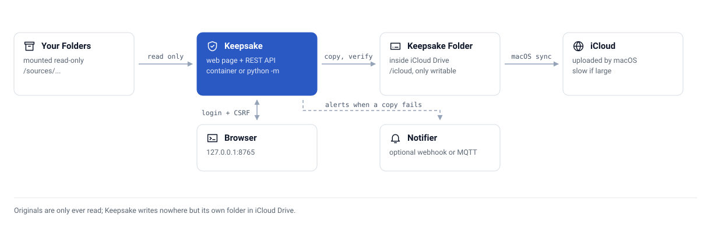
</picture>

---

## 🖼️ Screenshots

Demo data only (generic folders in a temporary directory).

| Folders | Add folder | Folder settings |
|---|---|---|
| 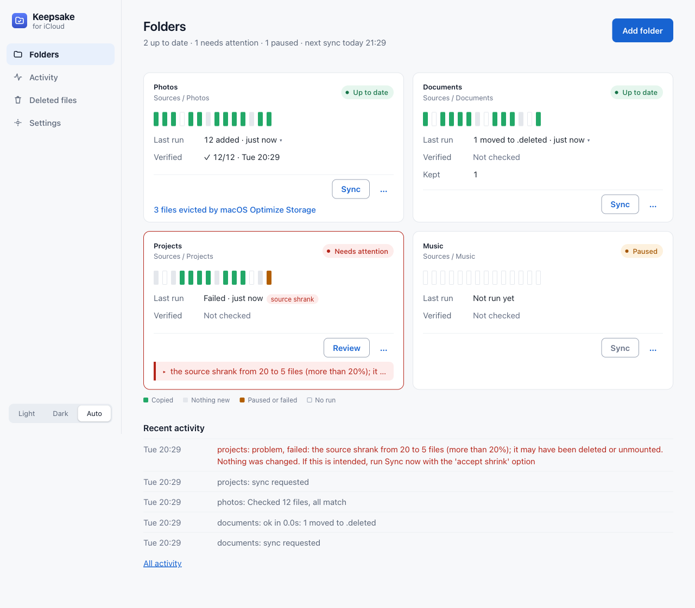 | 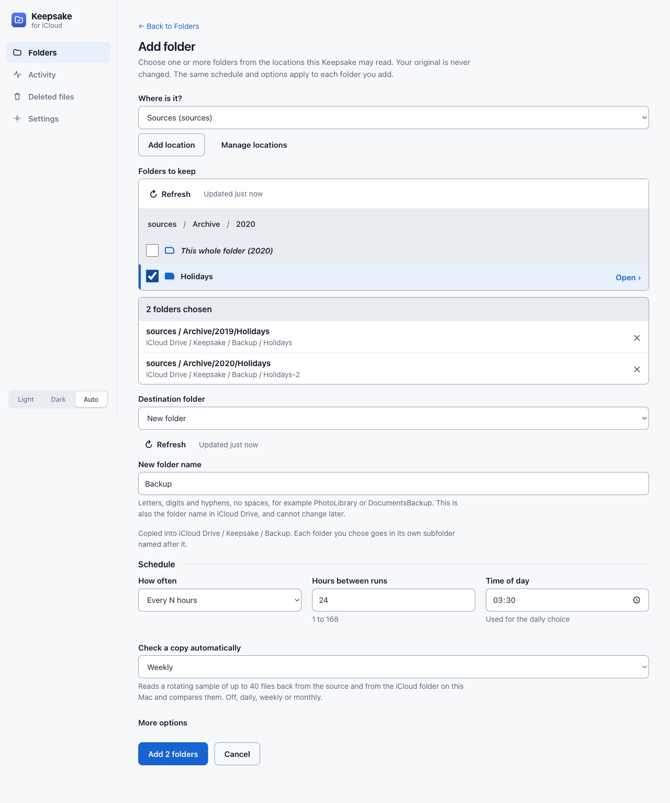 | 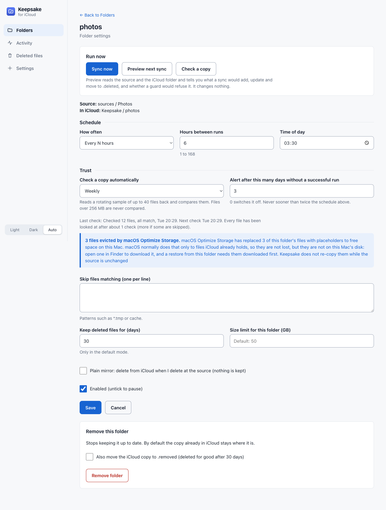 |

| Guided setup: first step | Guided setup: choosing folders |
|---|---|
| 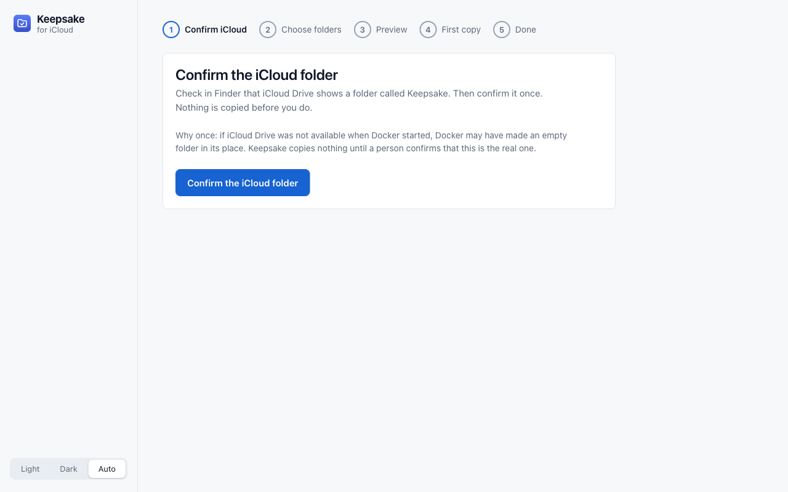 | 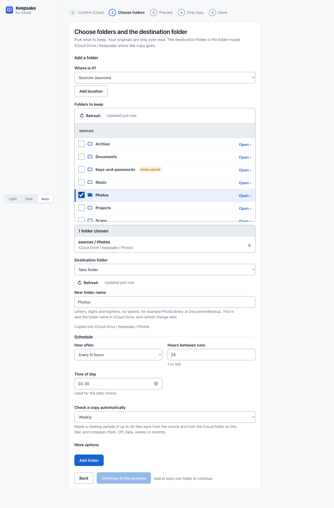 |

| First run | Preview next sync | A night's detail | Paused |
|---|---|---|---|
| 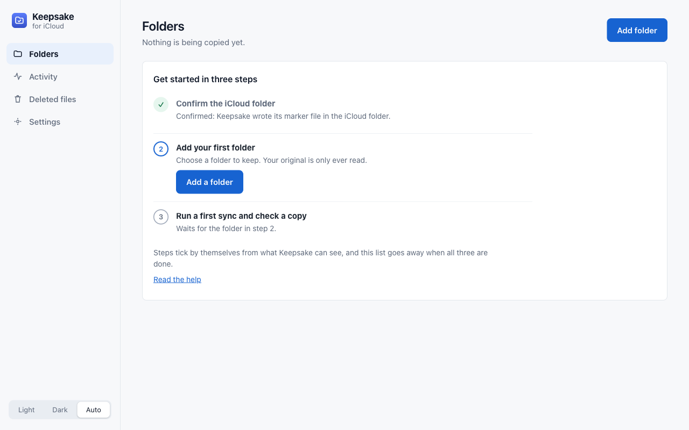 | 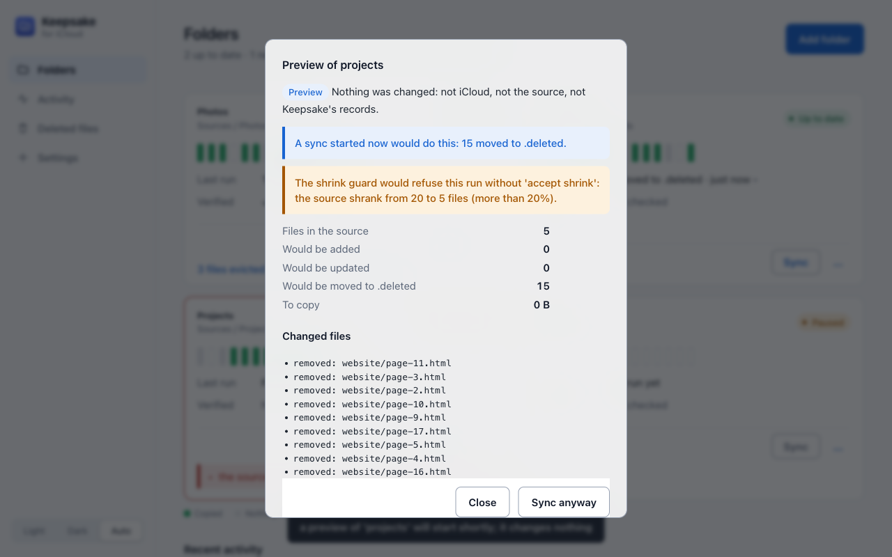 | 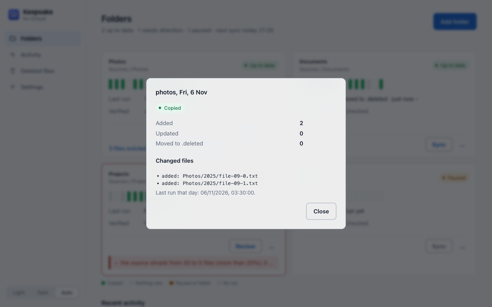 | 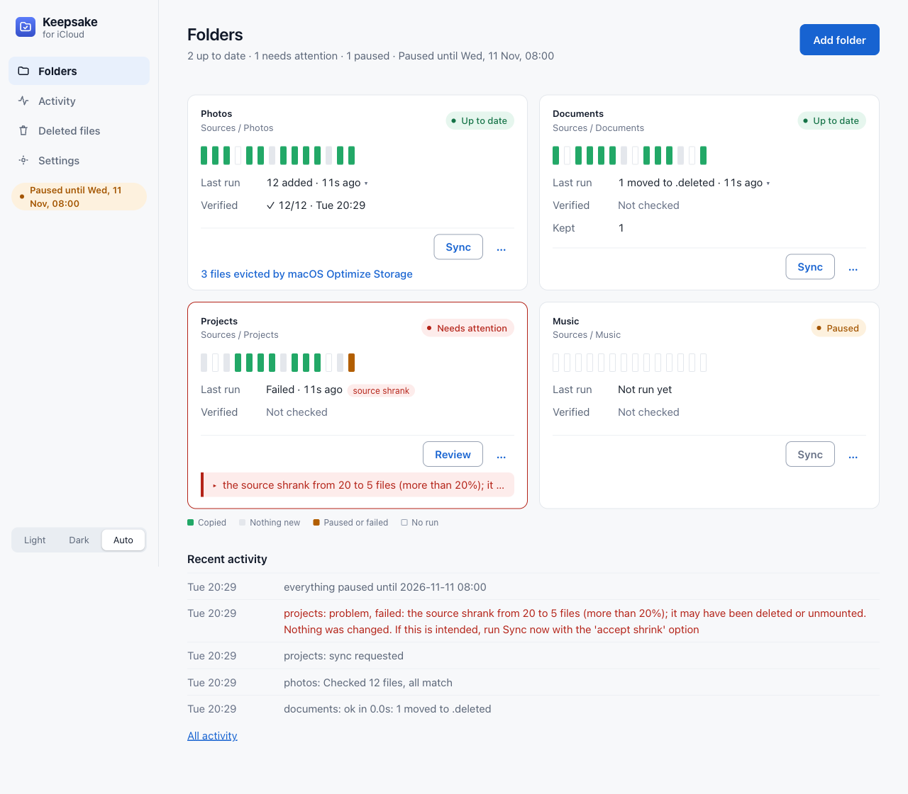 |

| A copy in progress |
|---|
| 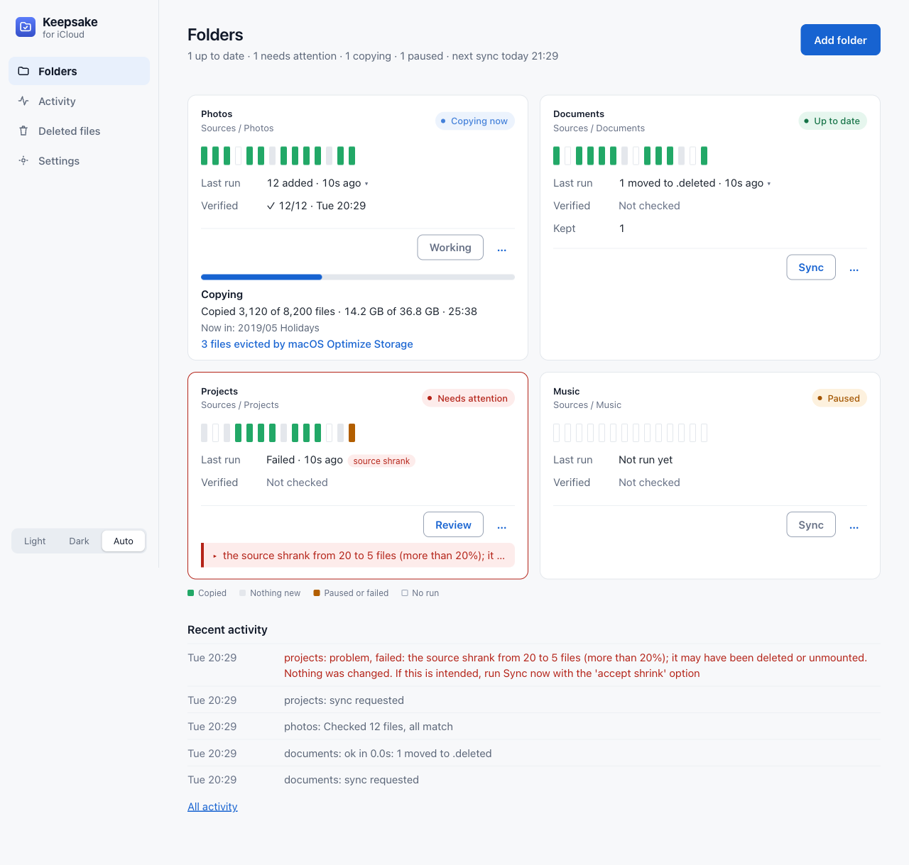 |

Dark mode and phone widths: [`docs/assets/screenshots/`](docs/assets/screenshots/) holds every page, plus `first-run`, `setup-confirm`, `setup-folders`, `preview`, `progress`, `night` and `paused`, as `keepsake-<page>-{desktop,phone}-{light,dark}.png`. On a phone the folder cards stack in one column and the menu is a tab bar at the bottom edge. The bars before today in the screenshots are seeded demo history.

---

## 🚀 Quick Start

On a Mac with Docker Desktop (full walk-through: [docs/macos-docker-desktop.md](docs/macos-docker-desktop.md)):

```bash
git clone https://github.com/CaputoDavide93/Keepsake-for-iCloud.git
cd Keepsake-for-iCloud
cp .env.example .env        # set KEEPSAKE_PASSWORD and the two *_HOST_DIR paths
docker compose up -d --build
open http://localhost:8765
```

Then in the page: **Settings, Locations, Confirm iCloud folder** (once), then **Add folder**. Nothing is copied until you do both.

Native on macOS, no Docker:

```bash
KEEPSAKE_DATA="$HOME/.keepsake" \
KEEPSAKE_ICLOUD_DIR="$HOME/Library/Mobile Documents/com~apple~CloudDocs/Keepsake" \
KEEPSAKE_ROOTS="documents=$HOME/Documents" \
PYTHONPATH=src python3 -m keepsake
```

It needs Python 3.11 or newer and nothing from PyPI.

---

## ⚙️ Configuration

Precedence: environment variable, then `config.json` in the data folder (or `KEEPSAKE_CONFIG`), then the default. [`.env.example`](.env.example) lists every variable and [`config/config.example.json`](config/config.example.json) shows the file form. The caps and the notifier can also be changed on the Settings page; those values are saved in `settings.json` in the data folder.

| Variable | Purpose | Default |
|---|---|---|
| `KEEPSAKE_ROOTS` | Where sources may be read from: `name=/path,name2=/path2`. Names are letters, digits and hyphens and keep their case, for example `PhotoLibrary`. The web page can only browse inside these and the locations added on the Locations page. These are built in | `sources=/sources` |
| `KEEPSAKE_LOCATION_PREFIXES` | Broad folders, mounted read-only into the container, that locations can be added under from the page: `/hostfs,/other`. Nothing outside them, and nothing on a writable mount, can become a location. See [docs/macos-docker-desktop.md](docs/macos-docker-desktop.md) | `/hostfs` |
| `KEEPSAKE_ICLOUD_DIR` | The Keepsake folder inside iCloud Drive, the only writable path | `/icloud` |
| `KEEPSAKE_DATA` | Jobs, state, settings, activity log, manifests | `/data` |
| `KEEPSAKE_MAX_DEST_GB` | Largest a folder may grow in iCloud | `150` |
| `KEEPSAKE_MIN_FREE_GB` | Free disk the Mac must keep | `20` |
| `KEEPSAKE_SHRINK_PCT` | Shrink guard threshold | `20` |
| `KEEPSAKE_FS_ROOTS`, `KEEPSAKE_ROOT_MARKERS` | Extra proof that a source is a live mount (below) | none |
| `KEEPSAKE_HOST`, `KEEPSAKE_PORT` | Where the web page listens | `127.0.0.1`, `8765` |
| `KEEPSAKE_PASSWORD`, `KEEPSAKE_PASSWORD_FILE` | Required for any non-loopback address | none |
| `KEEPSAKE_NTFY_URL`, `KEEPSAKE_NTFY_TOKEN` | ntfy topic address (the secret) and optional access token; each also as `_FILE` | none |
| `KEEPSAKE_PUSHOVER_TOKEN`, `KEEPSAKE_PUSHOVER_USER` | Pushover application token and user key (both needed); each also as `_FILE` | none |
| `KEEPSAKE_MQTT_HOST`, `_PORT`, `_USER`, `_PASSWORD`, `_PREFIX` | MQTT alerts (and status). The password also as `KEEPSAKE_MQTT_PASSWORD_FILE` | none, `1883`, none, none, `keepsake` |
| `KEEPSAKE_MQTT_DISCOVERY_PREFIX` | The topic prefix your hub listens on for MQTT discovery. Empty: alert events only | none |
| `KEEPSAKE_SMTP_HOST`, `_PORT`, `_SECURITY`, `_USER`, `_PASSWORD`, `_FROM`, `_TO` | E-mail alerts. Security is `starttls`, `ssl` or `none` (a login is refused with `none`); the password also as `KEEPSAKE_SMTP_PASSWORD_FILE` | none, `587`, `starttls` |
| `TZ` | Time zone for "daily at 03:30" | `UTC` |

The rest (pause, speed limit, cookie flag, allowed host names, webhook) are in `.env.example`.

A source that lives on a network share can be proven real: list it in `KEEPSAKE_FS_ROOTS` (its directory must be the root of a mounted filesystem, which is true for a mounted share and false for a plain folder left where a share used to be) and/or put a marker file at its root and name it in `KEEPSAKE_ROOT_MARKERS=name=.keepsake-root`.

---

## 📖 Usage

| Page | What it is for |
|---|---|
| Guided setup | Shown by itself on a new install, from any address, until it is done: confirm the iCloud folder, choose the folders and the destination folder, preview, make and check the first copy. No menu and no skip; reopening the page resumes the step |
| Folders | One card per folder in a grid that follows the screen width (one column on a phone): its name, status, the last 14 nights, what the last run did and how long ago (`12 added · 18s ago`, or `Failed` with a short tag), how many files the last copy check matched with when (`✓ 40/40 · Tue 14:24`, or `✗ 2 differ` in red), and a number only when the last run kept files in `.deleted`. The exact values are in each cell's title and read out in full to screen readers; the next check is in the title. A note per folder when macOS evicted files; errors in plain words under the row, cut to one line and opened with a press. Sync (or Review after a shrink refusal: accept a smaller source, after a confirmation, with a Preview offered first) is on the card; Preview, Check and Edit are in its “…” menu, which opens from the keyboard. Each night's bar opens its detail. A short first-run checklist shows until the three setup steps are done, and a chip in the side rail says when everything is paused. A one-line summary with the next sync, a colour legend and the five latest log lines |
| Add folder | Tick one or more folders in the allowed locations (Refresh re-reads the list), choose the destination folder in iCloud Drive / Keepsake (an existing one, or a new name), then a schedule and how often to check a copy. Several folders go into one destination, each in its own subfolder |
| Locations | The places Keepsake may read, shown readably (`HomeFolder` as Home Folder). Add one from the folders mounted read-only under `KEEPSAKE_LOCATION_PREFIXES`, or remove an added one; locations from `KEEPSAKE_ROOTS` are built in |
| Deleted files | In the side rail: pick a folder, then see what is kept under `.deleted` for it, grouped by date, with Restore per file, Restore all from this date and Restore everything kept |
| Folder settings | Reached from the folder name or Edit: Sync now, Preview next sync and Check a copy, then schedule, automatic check, stale-run alert, excludes, retention, size cap, plain-mirror mode, pause, remove; the last and next check and the evicted-file note |
| Activity | What Keepsake did, newest first: one compact line per entry, grouped by day, with a Problems only filter and a folder choice |
| Settings | Tabs, remembered in the address (`#/settings/alerts`): Limits (safety caps, saved with Alerts), Alerts (the webhook, which alert channels are configured, Send test alert), Pause (Pause everything with presets or a date and time, and quiet hours), Locations (the one-time iCloud confirmation, and the places Keepsake may read, which you can add and remove), Diagnostics (Download diagnostics), Security (Change password) when the page has a password, and Help (the first-run help in short sections, also reached at the old `#/help` address, which redirects). Edits you have not saved stay when you switch tabs, and the page says so |

The same actions are a REST API ([docs/api.md](docs/api.md)). A job has a name, a root, a source folder inside it, a schedule, a mode (`mirror-keep-deleted` by default, or plain `mirror`) and optional excludes and caps.

For a notification on the Mac when a folder needs attention, see [docs/macos-notifications.md](docs/macos-notifications.md) (optional, never required).

---

## 📁 Repo structure

```text
Keepsake-for-iCloud/
├── src/                # 🧠 the keepsake package: engine, service, server, web page
├── tests/              # 🧪 unit, API, scrub and docs-truth tests; UI smoke test
├── tools/              # 🔧 scrub, diagram generator, screenshot and fixture tools
├── scripts/            # 🛠️ docker smoke test, git hooks
├── config/             # ⚙️ config.example.json
├── docs/               # 📚 guides, safety model, API, screenshots
├── .github/            # 🤖 CI workflow
├── README.md           # 📄 you are here
├── LICENSE             # 📄 MIT
├── SECURITY.md         # 🔒 reporting and data handling
├── CONTRIBUTING.md     # 🤝 how to contribute
├── CHANGELOG.md        # 📝 what changed
├── AGENTS.md           # 🤖 rules for anyone working in the repo
├── llms.txt            # 🤖 summary for language models
├── Dockerfile          # 🐳 small pinned image, non-root
├── docker-compose.yml  # 🐳 read-only root, source mounted read-only
├── .env.example        # ⚙️ every variable
├── .dockerignore       # 🐳 keeps the image small
├── .gitignore          # 🙈 secrets block included
├── Makefile            # 🧰 make check, make docker-smoke, ...
└── pyproject.toml      # 📦 project metadata and lint settings
```

---

## 🧪 Testing

```bash
make setup      # once: .venv with the lint tool (Python 3.11+)
make check      # lint, tests, scrub, diagram: the gate
make docker-smoke   # builds a throwaway image, runs it on a temp fixture, removes everything
make ui-setup && KEEPSAKE_CHROMIUM=/path/to/chromium make ui-test
```

All tests use a temporary directory: never your iCloud Drive and never a real folder. The engine suite carries one fixture per attack it defends against (symlinked reserved folders, symlinked temp files, a wrong mount, a shrunk source, an unowned destination, an evicted placeholder). `tests/test_scrub.py` fails if a private identifier reaches a tracked file.

---

## 📦 Deployment

Keepsake is one container or one Python process. The compose file runs it with a read-only root filesystem, no capabilities, `no-new-privileges`, a non-root user, a 768 MB memory limit and a health check; the web page is published on `127.0.0.1` only. [docs/security.md](docs/security.md) explains what to do if you want to reach it from another device (a TLS reverse proxy in front, never a wider port mapping).

---

## 🛠️ Troubleshooting

| You see | It means | Do |
|---|---|---|
| "Nothing is copied until you confirm the iCloud folder" | No marker file in the iCloud folder yet | Check Finder shows `Keepsake` in iCloud Drive, then Settings, Locations, Confirm iCloud folder |
| "the iCloud folder is not mounted" | The container cannot see iCloud Drive | [Docker Desktop guide](docs/macos-docker-desktop.md), file sharing and the path |
| "looks empty right now" / "shrank from X to Y" | The source lost files, or its mount is gone | Check the share is mounted. If the loss is real, Sync anyway on the Folders page |
| "already holds files that this service did not put there" | An existing iCloud folder with that name | Pick another name, or tick the take-over box when adding |
| Refuses to start, "needs a password" | `KEEPSAKE_HOST` is reachable by other devices | Set `KEEPSAKE_PASSWORD` (10+ characters) or use `127.0.0.1` |
| You forgot the page password | It was changed in Settings, or you no longer have `KEEPSAKE_PASSWORD` | On the Mac, run `docker exec -it keepsake python3 -m keepsake reset-password` ([details](docs/security.md#forgot-the-password)) |

---

## 🔒 Security

Binds to `127.0.0.1` by default; refuses to start on any other address without a password; CSRF token, same-origin and JSON-only checks on every change; rate-limited login; a strict content security policy; no cookies without `HttpOnly` and `SameSite=Strict`; no secrets in logs. Mount your sources read-only. Details, threat model and residual risks: [SECURITY.md](SECURITY.md) and [docs/security.md](docs/security.md). How the engine protects your data: [docs/safety-model.md](docs/safety-model.md).

---

## 🤝 Contributing

See [CONTRIBUTING.md](CONTRIBUTING.md). Run `make check` first.

---

## 📄 License

[MIT](LICENSE).

---

<p align="center"><sub>Made with ❤️ by <a href="https://github.com/CaputoDavide93">Davide Caputo</a></sub></p>
